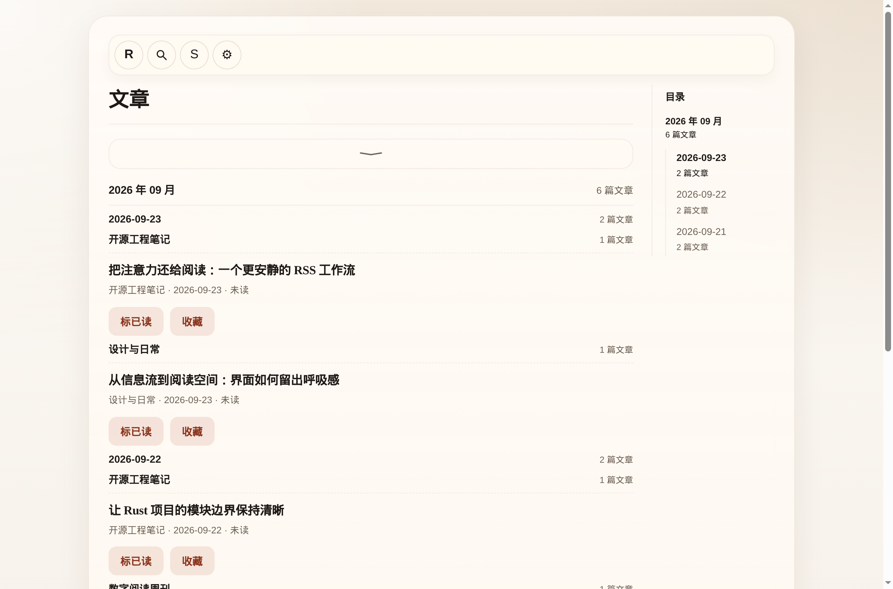

# RSS-Reader

> Subscribe, then read.

<p align="center">
  <a href="https://github.com/Develata/RSS-Reader/releases/latest"></a>
  <a href="https://github.com/Develata/RSS-Reader/actions/workflows/ci.yml?query=branch%3Amain"></a>
  <a href="../LICENSE"></a>
  <a href="#get-started"></a>
</p>



_Actual Web interface with sample subscriptions and articles._

RSS-Reader is a local-first RSS reader built with Rust and Dioxus. Desktop, Web, Android, and CLI share the same core subscription and reading behavior. Desktop and Android keep a library on the device. Self-hosted Web keeps one library on the server, shared by browsers and the CLI using that server data directory. JSON, OPML, and optional WebDAV exchange subscriptions and settings between separate libraries.

Implementation notes below describe the v0.2 development branch, not a published v0.2 release; the asset table retains its historical v0.1.22 verification.

[Latest release](https://github.com/Develata/RSS-Reader/releases/latest) · [Release notes](https://github.com/Develata/RSS-Reader/releases) · [中文](../README.md) · [Documentation](./README.md) · [Issues](https://github.com/Develata/RSS-Reader/issues)

## Get started

Download the appropriate asset from [Releases](https://github.com/Develata/RSS-Reader/releases/latest):

| Device | App asset | Start |
| --- | --- | --- |
| Windows x64 | `RSS-Reader-windows-x86_64.zip` | Extract to a writable directory and run `RSS-Reader.exe`; WebView2 Runtime is usually required |
| Linux x64 | `RSS-Reader-linux-x86_64.deb` | Install where the package dependencies are available; data is stored under the user's XDG data directory |
| macOS Intel / Apple Silicon | `RSS-Reader-macos-x86_64.tar.gz` / `RSS-Reader-macos-aarch64.tar.gz` | Extract to a writable directory and open `RSS-Reader.app` |
| Android ARM64 | `RSS-Reader-android-arm64-v8a-release.apk` | Install the APK; the AAB is for app stores |
| Web | `RSS-Reader-web.tar.gz` | Historical v0.1.22 static asset; the v0.2 Web page requires a matching [`rssr-web`](./deployment/web.md) server build |

Open Subscribe (the RSS-wave icon in the top bar), add an RSS/Atom URL or a website homepage, then select **R** (Read / Home). From another page, R navigates home; when already home, R manually refreshes all feeds. Repeated clicks share the in-flight refresh. On mobile, pull down at the top of Home to request the same refresh.

The table matches the published `v0.1.22` assets; see the [release notes](https://github.com/Develata/RSS-Reader/releases/tag/v0.1.22) for the exact changes and validation scope. Android's signed APK/AAB was built and checked, but system back, long-press text selection, pull-to-refresh, and image gestures still need real-device acceptance. macOS interaction also remains unverified on a physical machine.

**Linux package:** `v0.1.17` fixes the earlier `.deb` data-directory permission problem and declares its linked library dependencies. The `v0.1.22` release workflow also installed its package on Ubuntu 24.04 and launched it twice as an ordinary user under Xvfb, checking database creation and reuse in a path with Chinese characters and spaces. Minimum library versions come from the Ubuntu 24.04 build environment; check the package's `Depends` before installing on another distribution, especially an older one.

## Reading workflow

- Use the search icon to expand title search; Enter searches, Esc closes it. Filter entries by source, unread status, or favorite status. Long source names remain readable and pagination stays reachable.
- In Reader, use the top-left back button, toggle read/favorite, move to nearby articles, or open a body image in the viewer. Native text selection and copy remain available. Refreshing does not replace the article you are reading.
- Reader shortcuts: `M` toggles read status, `F` toggles favorite, and `←` / `→` move to the previous / next unread article. Shortcuts apply only while focus is inside the reading region. Search input, IME composition, and native editing shortcuts with Ctrl or Cmd are left alone.
- Settings provide built-in themes and custom CSS. Basic settings and edited CSS require Save; applying a preset saves immediately. Android CSS file import is not implemented; export uses the system file picker. `rssr-cli` covers feed management, refresh, settings, and configuration import/export.

- The arrow at the end of the navigation bar collapses it to one expand button. Collapse state and reading positions last for the current run; reloading the Web page clears them. Returning to the list restores the page and article position where possible.
- Reader metadata shows the feed, author if available, local publication time, and an original-page link. Full timestamps include the UTC offset; the link opens externally without leaving Reader. Source filters show the same full unread counts as the subscription page, including zero.
- “Mark filtered entries as read” previews all matching unread entries across pages. Confirmation is required again if the matching set changes. CLI `mark-read --all` or `mark-read --feed-id <id>` previews; `--yes` executes.
- Website subscription discovery selects a single declared feed automatically, or lets you choose among multiple candidates. Without declarations it probes only `/feed`, `/rss.xml`, `/atom.xml`, and `/index.xml`. CLI lists multiple candidates and exits unsuccessfully so a specific feed URL can be chosen.
- Manual refresh reports newly inserted entries; updates to existing entries do not count. Partial failures retain successful results. Success feedback lasts about three seconds, errors about six. Fetch and discovery responses are limited to 8 MiB after decompression and UTF-8 conversion.

## Local data and limits

The Linux `/usr/bin` installation stores data in `$XDG_DATA_HOME/rss-reader/` (or `~/.local/share/rss-reader/` when unset); macOS uses `~/Library/Application Support/RSS-Reader/`; Windows and portable Linux builds use `RSS-Reader/` next to the executable. From v0.2 the directory holds one library, `library.sqlite3` (subscriptions, articles, bodies and settings), plus `shell-prefs.json`; SQLite's `-wal`/`-shm` files and `library.sqlite3.create-lock` are normal companions. Exit the app before backing up the whole directory. When upgrading from v0.1.x, the first start imports the old databases in the same data directory (`rss-reader.db`, `rss-reader-content.db`) one way into the new library and leaves the old files untouched; close every old version first. A failed import does not create an empty library. On macOS, v0.1.x kept its data inside the app bundle (`RSS-Reader/` next to the executable, usually `RSS-Reader.app/Contents/MacOS/RSS-Reader/`), which replacing the bundle deletes: before upgrading, quit the old version and copy every file in that directory (`rss-reader.db`, `rss-reader-content.db`, and any `-wal`/`-shm` files) into `~/Library/Application Support/RSS-Reader/`, then start the new version (before the first start of either the new desktop app or the new CLI). Data created by an earlier root-run package under `/usr/bin/RSS-Reader/` is not migrated automatically; after exiting, back it up and have an administrator copy the complete directory to the new location and give it to the user. Android stores its databases in the app sandbox; uninstalling removes local data. Formal Web stores its library in the server data directory; clearing browser site data does not delete that library. See the server backup procedure in the [deployment guide](./deployment/web.md).

Formal Web uses the same-origin `/api/v1` through `HttpBackend`; feed fetching and automatic refresh run on the server. Focus, visibility, reconnection and completed jobs trigger read-only updates without replacing the body being read or pending edits. A build mismatch offers a reload and tries to keep settings/CSS edits in this tab’s `sessionStorage`; restored edits are not saved automatically.

**Upgrading from the old Web build:** browser articles, read flags and favorites are not migrated. Export a JSON configuration or OPML in the old version, import it after signing in to the new server, then fetch feeds again. Formal Web is no longer an offline reader and does not fall back to the old browser library. Preserve old site data if you still need those articles. Only the [Pages demo](./deployment/github-pages.md) continues to use `localStorage` and Web Locks; feed operations, WebDAV and automatic refresh are disabled there.

A separately extracted Linux CLI remains portable and uses its own executable-adjacent data directory by default. To manage the installed desktop app's library, pass the global `--data-dir` option (or set `RSSR_DATA_DIR`) to the installed data directory.

The reader caches the body provided by the feed; it does not fetch the source page to reconstruct full text. Desktop, Android and the server attempt to localize body images. Formal Web sends reader operations to its own server; it does not fetch feeds directly from the browser. The old feed proxy endpoint has been retired. JSON, OPML, and WebDAV exchange subscriptions and settings, **not** article bodies, read history, or favorites across devices. See the [Web deployment guide](./deployment/web.md).

The product stays focused on subscriptions, reading, basic settings, and basic configuration exchange. See the [functional design philosophy](./design/functional-design-philosophy.md).

## Build and verify

Rust stable is required. Web development also needs the `wasm32-unknown-unknown` target and Dioxus CLI `0.7.9`.

```bash
cargo run --locked -p rssr-app
cargo run --locked -p rssr-cli -- --help

rustup target add wasm32-unknown-unknown
cargo install dioxus-cli --version 0.7.9 --locked
bash scripts/run_rssr_web_browser_smoke.sh
bash scripts/run_server_web_regression.sh --suite acceptance --long
```

```bash
cargo fmt --all --check
cargo clippy --locked --workspace --all-targets -- -D warnings
cargo test --locked --workspace
cargo check --locked -p rssr-app --target wasm32-unknown-unknown
```

The [mainline validation matrix](./testing/mainline-validation-matrix.md) explains the parallel CI jobs, platform checks, and remaining manual acceptance. A successful build alone does not establish Android or macOS device behavior.

## More documentation

- [Detailed user guide](./user-guide.md) (Chinese): subscriptions, reading, themes, WebDAV, and backups.
- [Web / Docker deployment](./deployment/web.md): the server library, same-origin API, login, and backups.
- [Android build and acceptance status](./roadmaps/android-release-roadmap.md).
- [Design](./design/README.md), [testing](./testing/README.md), and [contributing](../CONTRIBUTING.md).
- [MIT License](../LICENSE).
