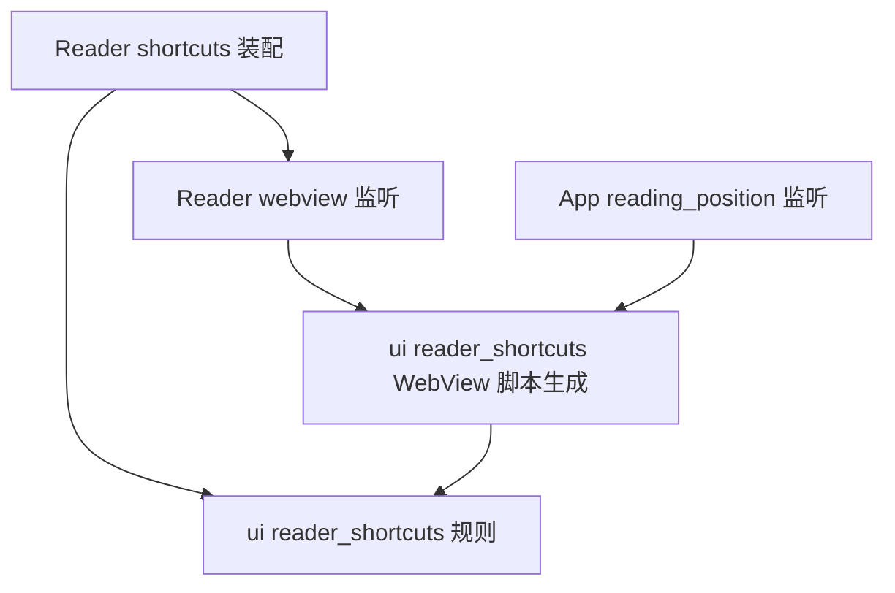

# 原生界面前置模块边界

核对日期：2026-10-30。页面生命周期等模块已通过 PR #40 进入 main；返回导航与提示策略已通过 PR #46 合入 `6a75fb83`；App 设置读取通过 PR #47 合入 `663ef4ee`。版本与验证状态统一见[维护状态](../current-status.md)。本文件不代表已替换 WebView，也不改变七个 crate 的职责。

## 近期目标与推进顺序

让 WebView 成为可替换的界面实现，让未来 Rust 原生界面直接复用交互规则。按实际替换成本排序：先以 Reader 证明规则可独立调用，再收敛所属功能的宿主操作入口，随后明确正文内容、图片资源、阅读锚点与 HTML/DOM 渲染实现的边界。JS 行数仅作辅助观察，不设削减指标。

规则接收普通输入、测量事实和操作结果；Dioxus 装配负责响应式发布与任务作用域；宿主执行负责同步默认行为、焦点、实际滚动、布局提交和监听清理。使用 Rust、web-sys 或包装 eval 都不能单独证明可替换性。没有真实第二种实现之前，不增加 crate、通用 UI 框架或全局宿主接口，也不把界面状态迁入 application/domain。

正文 HTML、自定义 CSS、语义样式接口、选择复制、IME 和无障碍继续是兼容要求。新的正文渲染器需要证明这些能力；本阶段保持现有渲染和样式，不创建通用文档 IR，不把现有宿主回归写成新渲染器验收。

## Reader 规则与装配边界（2026-10-30）

- `state.rs`、`intent.rs`、`reducer.rs`、`result_lifecycle.rs` 和 `image_viewer_state.rs` 不依赖 Dioxus。导航值直接复用 domain 的 `EntryNavigation`，不再经平台 bootstrap 引入；错误仍复用普通 Rust `UiFailure`，没有复制状态或类型。`Signal` dispatch 归 session；图片状态 hook 与组件归 `image_viewer.rs`，当前宿主桥接归 `webview/`。
- `ReaderResultScope` 读取现有状态中的文章 ID 与访问代次。加载、图片处理回执和标记写入共用访问归属；只读刷新在 `RereadIssued` 后额外捕获刷新代次，后续刷新或已应用标记使旧刷新失效。刷新代次不能作废同一次访问的标记写入，旧载荷不遍历、不复制正文。
- 刷新准入按原顺序判定：非当前文章忽略，读取失败走恢复加载，加载中记一次待刷新，内容就绪仅读标记与邻居。恢复加载仍先 `BeginLoading`、再标记不重复本地化图片；加载回执发布后才处理待刷新。执行与发布次序仍由 session 装配，保留原 Dioxus 集成测试。
- 加载和自动图片处理属于页面访问；用户已确认的标记写入属于 App。离页后写入继续，回执交给原有 Shell 提示与重读；不把取消页面等待解释为撤销写入。UI runtime 整体仍依赖当前装配，本批不声称全部 session/runtime 可原样移植。
- 图片开关状态只接收资源引用与替代文本。当前宿主继续解释 rendered source、图片点击/键盘激活、dialog 焦点、滚动锁定、关闭后的恢复和卸载；快捷键与切文前位置捕获仍由宿主同步执行。
- `scripts/check_reader_rule_boundary.py` 用同一生产源码和既有测试编译独立测试程序，仅显式链接 `rssr-api`、`rssr-domain`、serde；依赖构建不得出现 Dioxus/web-sys/Wry/Tao。不创建 Cargo package，也不使用替身状态。CI 在 `rssr-api` job 执行此检查；完整 app 测试继续验证装配。具体证据见[本批交接](../handoffs/2026-10-30-reader-rule-boundary.md)。

## Reader 宿主入口（2026-10-30）

`pages/reader_page/webview/` 集中当前 Reader 的图片激活、图片 dialog 和快捷键桥接。页面装配只接收 `ReaderImage`、原始按键字符串、关闭请求，并在 dialog 挂载后通知适配器；不再持有这些监听的 `Eval`、停止消息或脚本路径。宿主提取批次原样移动三个脚本；后续快捷键去重见下节，图片脚本继续保持原实现。

- `use_image_activations` 仍在 Reader 页作用域运行；`image_viewer.rs` 独占现有图片状态，换文章时关闭。资源引用与替代文本沿用原规则，不复制正文或另建浮层状态。
- `use_image_dialog` 仍在图片组件挂载后启动，负责原生 HTML dialog 的取消/背景输入、焦点、body 滚动锁与恢复。`use_listener_cleanup` 仅复用原 `use_drop` 停止消息，保留页面/组件任务作用域及等待中卸载的清理，不新加取消语义、代次或重试。
- `use_shortcut_keys` 仍在宿主同步过滤输入、阻止默认动作，并在切文前通过既有阅读位置入口捕获。普通 Rust 策略和共享脚本生成归 `ui/reader_shortcuts/`，session/navigation 派发归页面私有 `shortcuts.rs`；具体依赖见下节。
- 阅读位置继续复用 `ui/reading_position`，不为 Reader 再包装一套位置服务。该适配模块仍依赖 Dioxus 和 DOM，不是跨渲染器接口；独立性证据继续来自同一生产规则的无框架编译。

验收覆盖真实 Windows WebView2、Android 真机和正式 Web 的反复进入、键盘激活图片、关闭后回焦与恢复滚动、带浮层离页清理。离页后 Reader 监听和 observer 归零；受控路由切换、物理键盘/系统 IME 等边界见[宿主提取交接](../handoffs/2026-10-30-reader-host-boundary.md)。

## Reader 快捷键定义与同步边界（2026-10-30）

- `ui/reader_shortcuts/policy.rs` 的 `BINDINGS` 是按键与动作的唯一生产定义：左右方向键、J/K 导航、M 已读、F 收藏。逻辑键名是普通字符串；Rust 只对单字符绑定接受 ASCII 大写，命名键保持精确匹配，未知输入忽略。修饰键/组字排除仍可在读取键值前结束；规则不依赖 Dioxus、DOM 或路由。
- `ReaderShortcut::captures_position` 标识离开文章的动作。当前 `ui::reader_shortcuts::webview::script` 在各桥接启动时生成只读配置，沿用宿主小写键名匹配，将配置和同目录的 `shortcut_input.js` 一起放进该次 Eval；不依赖全局注册、额外异步握手或挂载顺序。此配置不是另一份交互状态，按键路径不重新生成配置。
- 两处监听共用输入过滤：重复、组字、Alt/Ctrl/Meta/Shift、表单/可编辑祖先、已打开的 dialog 和 Reader 页面存在性。**捕获阶段**仅为导航键测量并发出位置事实，按原行为忽略 `defaultPrevented`；**冒泡阶段**额外检查 `defaultPrevented`，同步阻止默认动作后才发送原始键值。目标节点后续停止传播不撤销已经发生的捕获。
- 位置监听仍属于原 App 适配器，快捷键监听仍属于 Reader 页；测量、消息序号、恢复、任务作用域和卸载规则不变。没有把同步默认动作交给异步 Rust 回执，也没有把两个监听合并到新的调度器。
- 同一生产规则的独立编译现为 24 项。实际宿主用每个视口 70 个受控边界、10 个有效键值及离页后的输入检查约束同步顺序，并验证导航/返回和标记写入；它们不是物理键盘或系统 IME 验收。源码、产物和结果见[快捷键去重交接](../handoffs/2026-10-30-reader-shortcut-definition.md)。

### 模块归属与依赖方向

Reader 专用的 Dioxus/session/router 装配位于 `pages/reader_page/shortcuts.rs`，不再放在全局 `hooks`。页面的 `webview` 模块为私有；App 阅读位置适配器只依赖共享快捷键脚本生成，不反向引用 Reader 页面。`ui/reader_shortcuts/` 不导入页面、路由或 Dioxus；其中 `policy.rs` 是普通规则，`webview.rs` 与 JS 只服务当前 WebView。规则独立性不能扩张为整个 `ui` 已脱离框架。

共享的是规则和脚本文本；页面和 App 继续各自持有监听生命周期，原回调及状态归属不变。此次移动的等价核对和三端基线/候选结果见[模块归属交接](../handoffs/2026-10-30-reader-shortcut-cohesion.md)。

下一阶段先收口已完成的依赖批次，再梳理正文内容、图片资源、阅读锚点、HTML/CSS、复制、IME 和无障碍的兼容契约；候选渲染器另行实测，不从本批推断整页已可直接迁移。

## 已有可独立测试的 Rust 规则

| 模块 | 负责的规则 | 当前界面适配职责 |
| --- | --- | --- |
| `ui/reading_position/controller.rs` | 本次运行的位置保存、访问代次、锚点回退、恢复期限、用户输入取消 | 页面测量、时钟、实际滚动、导航前捕获、生命周期 |
| `pages/entries_page/pull_refresh/gesture.rs` | 触点历史、方向、嵌套消费、阈值、释放和取消 | 触摸监听与 DOM 滚动余量测量 |
| `components/entry_filters` 的 `SourceFilterDraft` | 来源草稿、搜索、选择、取消、来源集合变化 | 表单、焦点、弹窗、原生半选外观 |
| `pages/entries_page/directory/controller.rs` | 上下文重置、活动路径、展开集合、跟随/手动、消息校验、回复和导航请求 | presenter 身份、Dioxus signal、事件桥接、渲染确认、滚动执行 |
| `pages/entries_page/directory/window.rs` | 可变行高缓存、可见范围、占位高度、测量变化时的锚点补偿、未挂载目标与焦点保留 | 当前挂载行与视口测量、同步键盘默认动作、提交确认后的滚动/聚焦 |
| `ui/reader_shortcuts/policy.rs` | 阅读快捷键、修饰键/输入法排除 | 将平台键盘输入映射为普通 Rust 值，由 Reader 私有装配执行导航和 session 命令 |
| `hooks/use_mobile_back_navigation/policy.rs` | history/fallback 选择、系统返回决策、首页提示及代次、超时和恢复前台 | 页面 dismiss 事实、路由事实、signal 投影、计时器、位置采集和 Android 退后台 |
| `ui/shell/settings_read_lifecycle.rs` | App 设置启动/只读读取、在途请求合并、页面读取归属、旧回执与错误归属 | App 任务作用域、命令执行、ThemeController 存储与响应式状态发布 |
| `pages/entries_page/request_lifecycle.rs` | 初始化/查询的独立代次、偏好就绪准入、旧结果过滤、写入后重查决策、列表到达后的返回页码顺序 | 页面任务作用域、命令执行、位置存储读取、signal 发布与既有查询触发 effect |

这些模块不直接查询数据库或网络。业务动作继续走 facade/session → `UiCommand` → runtime → `Backend` → application；平台 I/O 由 infra 的本地或 HTTP 适配器承担。前端交互状态不下沉到 application/domain，不建立另一份文章数据或第二套业务状态。

## App 设置读取生命周期的使用约束（2026-10-30）

- `settings_read_lifecycle.rs` 是 Shell 私有的普通 Rust 模块，只拥有读取状态和错误载荷。设置值及存储 revision 仍归 ThemeController，页面打开事实仍归现有 Shell；不复制设置或页面草稿。
- 后端确认自动刷新已启动后，重试/恢复/重新读取都只读设置；启动未抵达后端时，后续读取仍完成启动。设置读取失败不撤销已经收到的启动确认。
- 在途请求合并为一次后续读取。Settings 页面打开时自动读取在排队前即被抑制，显式重试与恢复仍可发起；排队请求完成时统一按自动读取处理，如果页面已打开则消费并放弃，关闭页面本身不补发。
- 成功回执只有在存储 revision 未变时才应用；等值存储也会使旧读取失效。成功读取即使不应用设置，也结束此前的重读错误。失败按**完成时**的存储 revision 归属，之后的存储使该提示失效。
- 页面应用存储设置后，启动错误立即隐藏；恢复 effect 只订阅 ThemeController 的存储变化，对生命周期使用 `peek`，避免错误/忙碌状态通知触发自我重试。读取任务仍属于 App，200 ms 输入合并计时器、监听与各页面读取策略保持原处。
- [本批交接](../handoffs/2026-10-30-shell-settings-lifecycle.md)区分普通 Rust、Dioxus 适配、正式 Web、真实 Windows WebView2 与 Android 编译检查；不以旧 Android 返回专项替代本批设备运行。

## 返回导航与退出提示的使用约束（2026-10-29）

- `policy.rs` 是 hook 内的私有普通 Rust 模块。工具栏与系统返回共用 history 优先、不同 fallback 次之、无目标则停留的选择；fallback 等于当前路由时不替换。
- 页面继续拥有浮层状态和 dismiss gate。策略只接收已消费、首页或已解析导航目标的事实；Entries 的来源筛选先于目录，Reader 图片查看器和 Feeds 来源编辑仍先消费返回。来源保存中消费返回但不关闭，不建立全局浮层副本。
- 首页系统返回不沿历史后退；首次显示提示并开始 5 秒计时，提示仍有效时再次返回才退后台。`BackPolicy` 独占提示状态与代次，返回给页面的 `Signal<bool>` 仅为显示投影，不参与决策。
- 超时是带提示代次的显式事件，旧超时不能清除新提示；恢复前台清除提示，不复用旧计时器身份。真实 sleep、窗口恢复和 JNI 执行仍在 hook/宿主适配器。
- 工具栏返回同步执行，继续由 DOM 捕获阶段保存位置。Android 系统返回才使用既有原子 guard，采集最多等待 500 ms，失败/超时仍继续；完成后只在路由未变化时重新解析并导航。`back_capture::finish_capture` 持有 guard 至该流程结束，任务未轮询或等待中取消均释放。
- 输入合并、页面监听代次及注销规则仍由原 `android_bridge.rs` 负责。单元测试、Dioxus 投影测试、Web 运行、原生编译与实际宿主验收分别记录，见[本批交接](../handoffs/2026-10-29-native-back-policy.md)。不从本次提取推断性能改善。
- 基线/候选的 Windows WebView2 与 Android 15 真机返回专项已通过，包含真实写锁等待下的保存门禁、系统返回、提示/恢复，以及宿主捕获回复的受控错误/超时/取消。证据及注入边界见[实际宿主回执](../handoffs/2026-10-30-native-back-validation.md)，不扩大为所有原生交互或正式包升级验收。

## 文章工作区请求生命周期的使用约束

- `EntriesRequestLifecycle` 只持有初始化与查询两种代次，二者互不失效。页面状态、写入 revision 和完整文章投影继续由既有 `EntriesPageState` 持有；每次请求只捕获少量标量，不克隆列表。
- 初始化开始时根据当前偏好状态决定是否加载偏好：Pending / Unavailable 加载，Loaded 保留。旧初始化的成功和失败都被拒绝；所有来源摘要仍按原命令加载。
- Pending 不准入文章查询，不轮询 Future；Unavailable 允许读取文章，保留既有错误提示和禁止保存回退偏好的规则。偏好写入策略和待保存队列在 `session/workspace.rs`，不属于查询代次模型。
- 查询完成先校验查询身份，再比较 `flags_revision`。旧身份直接丢弃；当前身份若遇到已完成写入，则在尚无新 `reload_revision` 时请求重查，否则仅丢弃。单独增加 reload revision 不等于使查询身份失效。
- 接纳后按原顺序输出 intent，仅在 `SetEntries` 后插入捕获的返回页码，由现有 reducer 对新结果集约束页码。失败结果、被拒绝结果都不能恢复页码；被拒绝的结果载荷不遍历、不复制。
- Dioxus 适配器以非订阅读取获取当前事实，先同步取得请求身份，再启动原页面作用域的任务。查询完成时的借用在发布前释放；页面销毁继续取消未完成任务。初始化和查询状态不进入 presenter 输入，也不新增自动查询循环。
- 单条/批量写入准入、偏好写入编排分别收拢在 `session/articles.rs` 与 `session/workspace.rs`，归档时钟和页面查询 effect 保持原位置。保留 facade/session 和 `UiCommand` 边界，不建立通用页面运行时。具体维护入口见[会话模块说明](../../crates/rssr-app/src/pages/entries_page/session/README.md)。

## 目录控制器的使用约束

- `reset` 只从页面/查询/分组的现有身份变化触发，提升 epoch 和渲染 revision；保留可见性，清除旧交互上下文。
- `receive` 一次检查 epoch/sequence，再完成状态转移和回复构造。过期事实不改变状态、不导航、不恢复滚动，但仍回复当前 epoch 和原请求 sequence，释放适配器的单条在途消息。
- 返回的 `set_page` 交给现有分页 reducer；同页是否需要更新不由控制器另行判断。
- `publish` 只表达渲染 revision 是否改变。序号变化或相同路径观测不要求发布 Dioxus signal；跟随命令仍可在无重新渲染时对齐。
- 单个 epoch 内桥接的本地控制器是唯一写者。另一写者只有重置 effect，且每次必定提升 epoch。适配器在处理下一事实前按 epoch 同步，保留“派发分页 → 按需发布 → 回复”的顺序。
- 展示层仅通过只读访问器读取状态；目录操作不进入文章查询/分组输入，不清空同页勾选。
- 现有事实及成功回复的 serde 字段保持不变。`directory/transport.rs` 区分单条消息解码失败与通道终止：前者返回拒绝回复并继续接收，后者结束监听并通知 DOM adapter 清理。拒绝消息只释放该私有单飞通道的一次等待，不重置 Rust 交互状态，不循环重试错误载荷。
- 时间目录和来源目录都使用同一文章叶节点组件及全局 `(index, id)` 引用校验。时间路径为月份 → 日期 → 文章，来源路径为来源 → 月份 → 文章；只有展开的路径挂载叶节点。测量器在两种分组下都观测具体文章。
- 超过 80 篇的展开文章分支使用独立窗口模型，保留完整全局文章引用；小分支继续直接渲染。窗口模型不进入查询/分组依赖，不复制业务数据，也不改变选择范围。
- 行高是宿主测量值；初始估计 56px、上下预留 240px 仅用于未测区域，不能作为固定行高契约。宽度变化使旧测量失效，变高行修正视口之前的偏移时补偿滚动锚点；纯滚动没有行高变化时不重建偏移索引。
- 几何缓存按目录 epoch 和分支身份保存。折叠/隐藏后复用；上下文重置后清除。焦点行可独立保留，不能为了保留一个远端焦点而挂载中间所有文章。
- 控件身份使用文章 ID，且必须位于动态行迭代器的键控根部；不能在外面增加无 key 的片段，以免范围变化时重建已有按钮并丢失焦点。
- 查询缩短投影与目录 epoch 重置之间可能有一帧过渡；已失效的窗口行应直接跳过，不能用无 key 的空节点混入键控迭代器。归档、筛选后仍须使用新投影的全局引用与分页身份。
- 可见范围桥接独立于展开/跟随桥接，单条在途；回复等待本窗口 revision 提交后执行。显式定位/聚焦后丢弃定位前排队的几何事实，下一帧重新测量，避免旧视口卸载新焦点。两条通道共用消息损坏恢复逻辑。
- 未挂载的跟随目标通过 Rust 全局引用找到逻辑行，先挂载后对齐；Tab/Shift+Tab 和方向键可跨越窗口边界，Home/End 可到分支首末篇，真实边界保留 Tab 离开分支的默认行为。
- 自动跟随的窗口回复只负责挂载目标，实际对齐统一由目录控制器适配器在确认没有更新的手动意图后执行；窗口适配器仅为显式键盘聚焦执行定位，不能让迟到的自动回复覆盖用户滚动。目录内 Tab/Shift+Tab 属于手动浏览，目录外 Tab 不作为主列表滚动输入。
- 每个窗口适配器同时绑定挂载节点、目录 epoch 和实例所有权；在异步回复后仍须重新检查。筛选、分页、分组或路由替换窗口后，旧回复不能测量、滚动或聚焦新目录，旧等待必须释放。
- 目录定位的 DOM 执行请求从点击时绑定序号、查询上下文、原页和目标页。Rust 接受且目标页提交后才能滚动；其他页面或查询取代该请求后，旧回复不能重建它，即使用户随后又返回原目标页。已就绪页面若已无该目标，也应结束等待。这是宿主等待提交的生命周期，不改变 Rust 的目标页判定、全局引用或分页 reducer。

## 阅读快捷键的使用约束

- 纯策略只输出上一篇、下一篇、切换已读、切换收藏；路由和业务副作用留给当前适配层。
- M/F 的大小写、左右方向键、修饰键及 composing 排除规则保持不变。Ctrl+F 继续交给浏览器查找，组合方向键不切换文章。
- 在排除修饰键/输入法之后才解析平台键值，不再调用显示字符串和小写转换；仍有 Dioxus 本身的事件数据成本，不宣称零分配或用户可感知的性能收益。
- 不新增按键重复抑制或 `prevent_default`。正文阅读区与搜索输入的作用域保持现状。
- `reading_position.js` 对切文按键的提前采集仍须与 Rust 快捷键边界一致；浏览器专项同时验证两侧。

## 暂时保留在宿主适配器中的工作

DOM 几何测量、原生对话框焦点/模态、同步阻止链接或空格默认动作、真实滚动、滚动来源归因、帧与提交确认，继续由现有适配器负责。不能为了减少 JS 行数而把同步事件处理改成异步往返，或在每帧传递整棵 DOM 的测量数组。

目录输入归因的时间窗口、阅读位置的 DOM 锚点识别等仍属于当前浏览器实现。未来原生适配应按相同交互契约提供对应事实和执行能力；当前抽取不等于已经具备原生渲染器。

下一阶段按本页开头的顺序复用规则、收敛所属功能的宿主入口。正文、图片、选择复制、焦点、输入法和系统返回需要各自的实际宿主验收；本批不选框架、不新增 crate、不迁移渲染器，也不扩大 Shell 重构。主题模式选择已完成[宿主评估](./native-theme-selector-assessment.md)：Android 已有系统弹窗，Windows 为 Chromium 控件，不重复实现。独立原生设置面板保留为后续候选，不再先于 Reader 独立性样本；实施前须明确窗口/session、样式和回退边界。

## 验证入口

- 纯状态与策略：`cargo test -p rssr-app --locked`。
- 初始化/查询适配：`scripts/browser/rssr_entries_lifecycle_acceptance.cjs`，通过离线 fixture 覆盖选择、筛选、写入失败/重试、偏好重开、查询稳定性，以及桌面/小视口搜索、刷新和阅读返回。基线和候选分别指定 `ARTIFACT_DIR`，构建目录可由 `PUBLIC_DIR` 指定。
- 目录实际行为：`scripts/browser/rssr_small_viewport_assertions.mjs --directory-only true`，包含日期/来源/文章层级、跨页、手动/跟随、显隐和选择保持。
- 隔离 fixture 回归：先构建正式 Web release 包，再运行 `scripts/browser/rssr_directory_offline_regression.cjs` 和 `rssr_directory_window_acceptance.cjs`。脚本启动真实同源服务器和隔离 SQLite 资料库，由无头 Chrome 操作当前构建，不依赖用户的线上订阅；后一脚本覆盖 600 篇单分支、变高行、焦点、跨页、显隐恢复及损坏测量通道。`rssr_directory_transport_acceptance.cjs --offline-fixture true --artifact-dir <path>` 同样使用隔离 fixture 核对旧目录通道。
- `scripts/browser/rssr_directory_window_boundaries.cjs` 延迟真实 Rust/WASM 回复，覆盖筛选/翻页/分组/返回后的旧焦点、被取代的跨页定位，以及来源筛选后末页正文返回的位置恢复。`rssr_directory_window_review.cjs` 补充手动浏览与自动跟随交错、隐藏时变宽和批量操作。
- 阅读位置及快捷键：`scripts/browser/rssr_reading_position_acceptance.cjs`，包含返回、切文、M/F、修饰键/IME、正文测量次数。
- 具体源码身份、命令和平台范围见 [2026-10-26 交接](../handoffs/archive/2026-10/2026-10-26-native-ui-preparation.md)。编译、浏览器运行、原生设备运行和性能结论分别记录。

## 原生验收后的优化顺序

`34a63202` 的 Windows / Android 实际目录、连续返回和本会话阅读位置恢复已验证；完整证据与未验范围见 [原生目录验收](../handoffs/archive/2026-10/2026-10-26-native-directory-validation.md)。真实输入法留待用户空闲，后台 WebView 的降频样本不能用作前台性能基线。

Android 展开一个包含 597 篇文章的来源月份时，渲染 trace 显示样式计算和布局是明确成本。现已按上述边界实现文章分支窗口化，功能、原生验收和测量范围见 [目录窗口化交接](../handoffs/archive/2026-10/2026-10-26-directory-windowing.md)。不切掉文章层级，不用固定行高假设，不改变查询或业务层职责；挂载节点、布局耗时、宿主往返延迟和内存应分别报告，不能仅凭节点数减少推断整应用更快。

## PR #40 与主线整合（2026-10-29）

在 main 8932a5ac 的 Backend、单库与逐字段 Settings 设计上接入：

- Entries 的 write_lifecycle.rs 输出写入准入和有序回执，后续读取映射到完整 Reread；preferences_policy.rs 只保留就绪准入，App 保存队列和来源编辑排序不变。
- Reader 的 result_lifecycle.rs 处理访问归属；主线的读取恢复、只读刷新和离页写入回执不变。
- Feeds 的 edit_state.rs 与 request_policy.rs 提供编辑状态、读取代次和反馈规则；保留主线 typed failure、配置指纹与 App 作业。
- Settings 的 draft_edits.rs 独占 submitted/pending 补丁转换和失败恢复，request_lifecycle.rs 独占读取身份、写入门禁和暂存读取；状态字段私有，session 仅经转换方法装配副作用。save_policy.rs 只准备逐字段补丁和汇总回执；stored → submitted → pending 规则不变。旧分支的整份草稿替换策略已退役。
- 保留 main 的主题卡片、导入与恢复默认仅预览、统一显式保存和离页撤销预览；主题文件归属、严格 UTF-8、可恢复文件错误和原生 BOM 传输兼容保留。数值解析提示改为字段投影代次，不影响逐字段保存。
- 验收与未来控件输入/取消边界见[适配契约](./native-control-adapter-contracts.md)和[验收入口](../testing/native-control-acceptance.md)。旧 BrowserStore 场景由当前真实服务器入口替换。
