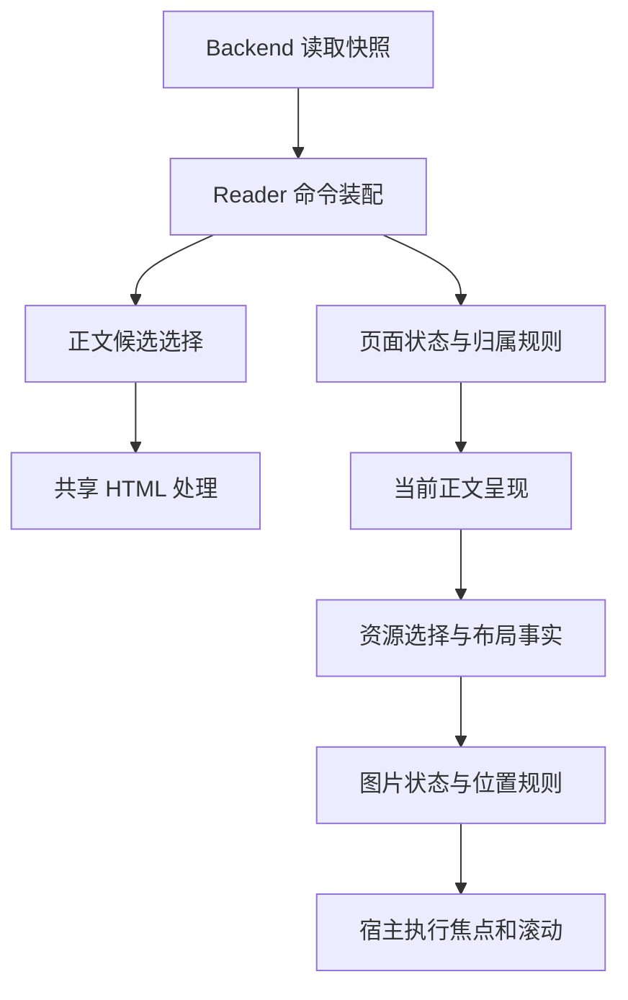

# Reader 正文、资源与渲染边界

核对日期：2026-10-31。正文选择归属已通过 PR #54 合入 main `465fead9`，主线检查通过，见[合并回执](../handoffs/2026-10-31-reader-body-merge.md)。本文件记录实现、兼容要求和下一批边界；没有引入原生正文渲染器或新的公共接口。

Reader 规则能脱离 Dioxus 编译，说明这些状态转移可复用；正文仍包含 HTML，图片地址与锚点仍由当前宿主解释。用普通 Rust 类型承载数据，不等于数据的呈现语义已脱离 WebView。

## 当前职责与依赖

| 层次 | 当前入口 | 数据与职责 | 替换界面时的边界 |
| --- | --- | --- | --- |
| 业务读取 | [ReaderService](../../crates/rssr-application/src/reader_service.rs)、现有 Backend | 同一快照取得文章、正文、导航、来源名；不暴露仓储指纹 | 继续复用业务读取、标记写入及错误语义 |
| 正文选择 | [runtime/reader/body.rs](../../crates/rssr-app/src/ui/runtime/reader/body.rs) | Reader 命令的私有普通 Rust 子模块，从 HTML、文本、摘要选择 `ReaderBody::Html/Text`，调用共享清洗 | 不依赖页面、Signal 或宿主；输出仍针对 HTML/文本呈现 |
| HTML 处理 | [infra html/reader.rs](../../crates/rssr-infra/src/html/reader.rs) | 地址与懒加载规范化、清洗、MathML 与解析预算 | 继续复用唯一处理链路；不能因更换控件绕过或复制解析政策 |
| 命令装配与页面状态 | [runtime/reader.rs](../../crates/rssr-app/src/ui/runtime/reader.rs)、[state.rs](../../crates/rssr-app/src/pages/reader_page/state.rs) | 生成加载回执；正文进入 `Arc<str>`，状态与访问归属沿用现有规则 | runtime/session 仍是当前装配；纯 reducer 与归属规则不另建状态副本 |
| 正文呈现 | [ReaderPage](../../crates/rssr-app/src/pages/reader_page/mod.rs) | HTML 放入 `reader-body-html`，文本放入 `pre`；布局、选区和样式由当前宿主完成 | HTML 插入、排版及主题兼容需要由候选渲染器实际证明 |
| 图片处理与打开 | [图片本地化](../../crates/rssr-infra/src/local_backend/image_localization.rs)、[图片事件](../../crates/rssr-app/src/pages/reader_page/webview/image_events.js) | 后端按预算缓存；宿主选择实际显示源并发出 `generation/src/alt`，普通规则核对访问身份 | 缓存写入属于后端；图片解码、源选择、激活和焦点属于宿主 |
| 阅读位置 | [Rust 控制器](../../crates/rssr-app/src/ui/reading_position/controller.rs)、[DOM 适配器](../../crates/rssr-app/src/ui/reading_position.js) | 普通事实驱动保存/恢复；宿主生成锚点、测量并执行滚动 | 复用恢复规则；当前 DOM 锚点不是跨渲染器书签 |

图中的职责不是待新增的类型或 trait。现有七 crate、Backend、LocalBackend 和唯一业务语义继续保持；没有第二种实现前，不建立通用文档 IR、全局 Host trait 或新资源数据库。

## 正文选择与生命周期

当前选择顺序以函数行为为准：

1. `content_html` 经清洗函数返回 `Some` 时，使用该 HTML。
2. 依次检查 `content_text`、`summary`；看起来是 HTML 且清洗函数返回 `Some` 时，使用该 HTML。因此 HTML 摘要可能优先于普通文本字段。
3. 否则使用 `content_text.or(summary)`；仅两者均缺失时显示“暂无正文”。空字符串不自动等同于字段缺失。

HTML 先进行显示规范化，再检查树构建预算、清洗并约束公式；超预算时按既有规则转成转义文本段落，返回 `None` 才回退到下一候选。普通清洗分支按去除首尾空白后的字符串是否为空判断，不另外执行 DOM 可见性测量。顺序、URL 策略和预算见[处理契约](./reader-processing-budgets.md)，不能用关闭清洗来补偿候选渲染器能力不足。

页面装配继续先发出 `BeginLoading`，结果按文章 ID 和访问代次归属。正文载荷进入共享的不可变字符串；已读、收藏和只读重读只更新相应状态，不替换正在阅读的正文。图片本地化成功后写回供下一次打开使用，当前页面没有新的正文替换回执，以保留选区、图片焦点和位置。离页后标记写入与页面读取的不同归属见[Reader 规则边界](./native-ui-preparation.md#reader-规则与装配边界2026-10-30)。

这些保留规则约束未来界面；现有 HTML 字符串本身仍不是可直接用于所有原生控件的富文本模型。

## 图片地址与资源所有权

- 业务正文可包含远端地址。当前 [BodyAssetLocalizer](../../crates/rssr-infra/src/fetch/client/body_asset_localizer.rs) 在预算内下载并生成 `data:<type>;base64,...`，失败或未处理的来源继续按既有流程保留。它不是独立图片文件 ID 服务。
- 浏览器负责 `picture/srcset` 的实际选择、图片解码和显示。打开图片时当前适配器读取 `img.currentSrc || img.src` 与 `alt`；图片状态只持有这些普通值。不能把此地址当作文章身份、缓存主键或未来原生资源句柄。
- 激活消息绑定正文的既有访问代次，以文本传输避免 JavaScript 数值精度损失；普通规则拒绝不匹配的代次，hook 拒绝未就绪正文。旧图片消息在切文后或返回同一文章的新访问中均不生效；这个短期消息身份不作为持久化资源 ID。
- 当前普通图片激活支持点击、Enter 和空格；修饰键、非主按钮和已有文本选择按原逻辑放行。打开后由 dialog 处理模态、焦点与滚动锁；关闭/卸载恢复已有 body 样式和滚动，原焦点节点仍连接时回焦。
- 内容指纹、陈旧缓存写回防护、预算及后台轮转继续归现有 infra/application 边界；详见[图片身份与预算](./reader-processing-budgets.md#候选与正文身份)。界面替换不增加另一份缓存状态或自行直接抓取正文。

未来宿主若使用自己的图片句柄，需要在所属适配器中完成地址到句柄的映射，并证明失败、取消和释放行为；本批没有定义这份接口或修改现有数据格式。

## 阅读锚点与坐标

当前保存位置仅属于本次运行。共享位置表记录页面 key、页码、绝对 y 和可选锚点/偏移，当前测量单位为 CSS 像素；恢复过程属于单次适配器生命周期，卸载清理表和监听。Reader 的 key 为 `reader:<entry_id>`。

DOM 适配器从正文中的 `p/h1/h2/h3/pre/li/blockquote` 选择块，用 `block:<序号>:<标签>:<前80个JS字符串代码单元>` 生成标识，并测量块相对视口的位置。Rust 控制器将锚点视为不透明字符串，不解析标签或文本。这个标识依赖 DOM 块顺序、标签和文本；它不是持久内容 ID，不承诺正文变化、换渲染器或跨运行后仍然有效。

当前恢复契约：

- 首次 Reader 访问没有保存值时从顶部开始；保存过的位置须匹配页面 key 和页码。
- 找得到锚点时用最新布局位置与原偏移计算目标；找不到时回退到保存的绝对 y，并限制在合法滚动范围内。
- 恢复校正限 2 秒，宿主每 100 ms 提供布局事实；用户输入、捕获或上下文切换可结束恢复。不能据此承诺任意延迟图片加载后永久保持锚点。
- 宿主按 visit/sequence 丢弃过期命令；等待后须重新确认当前页面，图片 dialog 锁定期间不采集临时正文坐标。
- 工具栏/快捷键仍同步采集离开前的位置；Android 系统返回最多等待 500 ms，采集失败仍继续原导航。具体取消、输入合并及宿主归属见[原生返回边界](./native-control-adapter-contracts.md)。

候选渲染器可以提供自身的布局锚点和逻辑坐标，但需明确单位与有效期，并以同一事件序列验证恢复规则。当前锚点不做静默跨宿主迁移；是否需要持久书签属于另外的产品与数据边界决策。

## 兼容面与验证证据

| 兼容面 | 现有依据 | 候选实现仍须证明 |
| --- | --- | --- |
| 内容选择、清洗与失败回退 | `body.rs` 的 8 项规则测试（同一源码也进入独立检查）；infra tokenizer/stress 与 `wasm_reader_html_contract_harness` | 同一夹具选出同样的内容；长文、表格、代码、MathML、危险 URL 和超预算降级不丢失政策 |
| 正文保留与异步归属 | Reader 纯 Rust 及 Dioxus 集成测试；现有宿主标记/切文回归 | 标记、重读、缓存完成、离页旧回执不销毁当前正文、选区和焦点 |
| 图片与位置 | `reader_host_scenarios.cjs`、`reader_shortcut_scenarios.cjs`、真实 Windows/Android/正式 Web 回执 | 地址选择、图片失败、布局变化、锚点失效、窗口变化及卸载均在真实候选宿主验证 |
| HTML/CSS 与主题 | [主题选择器契约](./theme-author-selector-reference.md)、[前端命令契约](./frontend-command-reference.md) | 既有 HTML 语义、官方主题与自定义 CSS 的支持边界；不能默认普通原生控件可解释 CSS，也不能静默删除兼容面 |
| 链接 | 原文 URL 只接受 HTTP(S)；[external_link](../../crates/rssr-app/src/bootstrap/external_link.rs) 区分 Web 新上下文与原生系统处理 | 原文、正文链接、修饰键以及窗口/系统处理保持语义；本批没有重新执行外部系统处理器验收 |
| 选择复制、IME、无障碍 | 当前 DOM 的选择、图片 alt/按钮角色、具名阅读区、live region 和焦点规则 | 实际文本选择/剪贴板、系统 IME、键盘与辅助技术；合成事件和普通 Rust 测试不能替代 |

上述“现有依据”是回归入口，不代表已经测试任何候选渲染器。独立检查现直接编译 `select_reader_body`，链接真实 `rssr-infra` 清洗，与既有规则共 35 项；检查的是本机依赖图无 Dioxus/web-sys/Wry/Tao，不代表整个 infra 无 I/O 或 HTML 呈现已脱离宿主。迁移前后的正文规则、当前运行结果与覆盖缺口见[正文选择交接](../handoffs/2026-10-31-reader-body-boundary.md)。历史宿主回归仍按[并发修复交接](../handoffs/2026-10-30-reader-race-fixes.md)的源码与产物归属。

## 下一批建议

命令装配对页面 `support.rs` 的正文选择引用已通过 PR #54 在主线消除：唯一调用方持有私有 `reader/body.rs`，迁移保持函数体一致。runtime 仍使用页面 intent 和加载结果类型装配回执；本轮没有声称全部 runtime 已脱离页面或 Dioxus。

这个有界样本已经整合；当前先单列定位偏好保存测试的不稳定点。后续提取应由实际复用阻碍驱动，不继续按文件数量拆分。保持当前 HTML 输出、页面状态、选择复制、主题和资源本地化时机；完整原生正文渲染器的选型、通用 Host 接口或内容模型迁移，要等具体候选及上述兼容证据再作决策。
